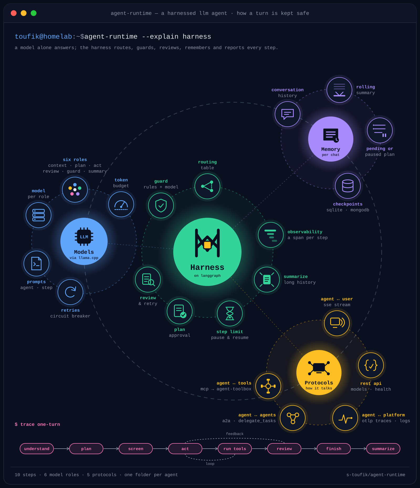

# agent-runtime

An agent served over HTTP. You send it a message; it answers straight away when it can, proposes a plan when the request needs tools, runs the tools once you approve, checks its own answer, and streams the reply back as server-sent events.

<p align="center">
  
</p>

One runtime, many agents: a folder `agents/<name>/` (its name, skills, tool scope, the routes its turns may take, its system prompts) turns the runtime into that agent, and each agent runs in its own process (`AGENT=<name>`). The supervisor answers what needs no data itself, and hands the parts that need the homelab's data or tools to the others over A2A, several at once when the parts are independent. See [Agents](#agents).

The model only answers. Everything around it is the harness: a routing table picks each step, a guard screens plans, you approve them, a reviewer checks the answer, a step limit pauses long runs, and every step is traced. It runs on six model roles, keeps a memory per conversation, and talks SSE to you, MCP to its tools, A2A to other agents and OTLP to the platform. The [Logic](#logic) section explains each part.

| Section | For whom | What's in it |
|---|---|---|
| **[Users](#users)** | You run it or call it | Run, the agents, call, read the reply, configure, logs |
| **[Developers](#developers)** | You change it | Architecture, layout, making changes, tests, deploying |
| **[Logic](#logic)** | Anyone who wants to know why it answered that way | Steps, routes, plans, typical journeys |

```text
                ┌──────────────────────────────────────────┐
  your app ────►│  agent-runtime                           │
  (homelab-ui)  │                                          │
       ▲        │  understand ─► plan ─► act ─► review     │──── OpenAI API ───► model server
       │        │                         │                │
       │        │                         └─► run tools ───│──── MCP ──────────► agent-toolbox
       │        │                                          │                    (or any MCP server)
       └────────│  SSE: status · progress · token · final  │──── storage ──────► MongoDB / SQLite
                │                                          │
  other agents◄►│  A2A: card · tasks · delegate_tasks      │──── agents/<name>/ ► which agent it is
                └──────────────────────────────────────────┘
```

---

## Users

### Run it

You need:

- Python 3.14 and [uv](https://docs.astral.sh/uv/)
- one or two OpenAI-compatible model servers: the homelab's llama.cpp, NVIDIA's API, or both
- optionally, an MCP server for tools (the agent starts without one)
- optionally, MongoDB for conversations and PostgreSQL for A2A tasks (local SQLite files are used when they're unreachable)

```bash
uv sync --group dev
cp .env.example .env      # fill in the model server, MCP server and storage
make run
```

| | Endpoint |
|---|---|
| Chat (SSE) | `POST http://<host>:<port>/v1/api2a` (the agent's `routes.api2a`) |
| Agents | `GET http://<host>:<port>/v1/agents`: this agent and the agents it can call |
| Models | `GET http://<host>:<port>/v1/models` |
| A2A (JSON-RPC, other agents) | `POST http://<host>:<port>/a2a`, card at `GET /.well-known/agent-card.json` |
| Health | `GET http://<host>:<port>/actuator/health` (also `/health/liveness`, `/health/readiness`) |
| Version | `GET http://<host>:<port>/actuator/info` |
| API documentation | `http://<host>:<port>/docs` (Swagger UI) and `/docs/openapi.json`, with `WEB_DOCS=true` |

`/health/readiness` answers `503` until the agent has booted, then `200`; it doesn't wait for the MCP servers. The boot log lists the tools found on each MCP server. A server that is down at boot, or goes down later, is retried in the background (after 5 s, then 10, 20, 40, and every 60 s), and its tools join as soon as it answers, with no restart. Servers that work are re-read every 60 s, so new tools of a new toolbox appear within a minute; a model that asks for a tool the agent doesn't know makes it re-read at once. Each server has its own loop and its own numbers: the `refresh` block of its connector in `config/<APP_ENV>/connector/mcp.yml` (`interval`, `retry_delay`, `max_retry_delay`), which `MCP_REFRESH_INTERVAL`, `MCP_RETRY_DELAY` and `MCP_MAX_RETRY_DELAY` override. Leave a variable unset rather than empty, or the configuration fails to load.

With Docker, `make docker_build` builds the image (see [Deploying](#deploying)).

### Agents

Every agent is this runtime started with `AGENT=<name>` (default `supervisor`); it reads `agents/<name>/` (`AGENTS_DIR`, default `./agents`) and becomes that agent:

```text
agents/<name>/
  agent.yml           the agent (root file; ${oc.env:…} works, like config/)
  skills/*.yml        optional: skills merged in, referenced from agent.yml as ${skills}
  prompts/<step>.md   optional: its system prompt for a step (understand, plan, act, review, screen, summarize)
```

| Field of `agent.yml` | Meaning |
|---|---|
| `name`, `description` | The agent card's name and description; the description is also `{identity}` in the prompts |
| `skills` | The A2A skills its card advertises (`id`, `name`, `description`, `tags`, `examples`) |
| `tool_scope` | The toolbox scope it connects to (`TOOLBOX_URL` + `/<scope>`); `all` for every tool, `none` for no toolbox |
| `turns` | The routes its turns may take: `direct` (answer without a plan), `clarify` (ask back), `plan` (plan, then run tools), `review` (check the answer). At least `direct` or `plan` |
| `peers` | The agents it may hand tasks to (`delegate_tasks`), each reached through the connector `agent_<peer>` |
| `routes` | Where its endpoints are: `a2a` (default `/a2a`) and `api2a` (default `/v1/api2a`) |
| `model` | Optional: the model this agent always uses, a name from `GET /v1/models` (e.g. `nvidia/nemotron-3.5-lightning-30b-a3b`). Every turn runs on it whatever the request asks (the UI menu, A2A metadata, the supervisor's model), and `GET /v1/models` and the card list only it. The server's pinned steps still apply. A model no provider serves stops the agent at boot. Without it, the request chooses |
| `guardrail` | `true` (the default) screens every plan before it runs and refuses unsafe ones; `false` runs approved plans unscreened. Every agent of the repository says it explicitly |

| Agent | turns | tool_scope | Prompts of its own |
|---|---|---|---|
| `supervisor` | direct, clarify, plan, review | `none`; `peers`: the six others | `plan`, `act` |
| `observation`, `analysis`, `coding`, `security`, `kitchen`, `travel` | direct, clarify, plan, review | their own scope | none (the generic prompts, with their identity) |

`kitchen` fixes its model: `model: nvidia/nemotron-3.5-lightning-30b-a3b`.

- **Prompts.** `adapter/outbound/llm/langchain/prompts/` keeps a generic system prompt per step; an agent's `prompts/<step>.md` replaces it for that step. At boot each one is checked: it may only use the step's `{placeholders}` (plus `{identity}`), and must use the ones the step can't work without (`{output_format}` where the answer is parsed, `{tools}` for plan, `{mode}` for act). Write a literal brace as `{{` or `}}`.
- **Turns.** The routing table keeps only the rows of the allowed routes, and the graph only the steps they reach. Without `direct`, a direct question or a rework is planned; without `plan`, a task is answered directly and the agent is never offered `request_plan`; without `clarify`, an ambiguous message takes the best reading; without `review`, an answer is final.
- **Peers.** An agent with `peers` reads their cards at boot and every minute after (an agent that comes up joins without a restart) and gets one tool, `delegate_tasks`: a list of `{agent, task}` sent at once, every answer coming back marked `answered`, `needs_input`, `refused`, `failed` or `unreachable`. Its plan puts independent parts in one step (parallel) and dependent parts in later steps (serial). Your approval of its plan covers the agents it calls: they run with `autoApprove` and the model of your turn (the tool gets the turn's conversation and model, `ToolContext`), each in its own part of the conversation: a `contextId` that is a UUID made from the conversation and the peer's name, the same one every time, within the 36 characters the A2A task table allows. It asks them with `SendStreamingMessage` and passes on, as its own `progress` events, everything they report while they work (see [Read the reply](#read-the-reply)), so a person sees each agent it asked, that agent's plan and its tool calls, and several agents working at once. While it waits on a task, it also counts it in the metric `agent.delegations.active` (`peer` = the agent; `agent_delegations_active` in Prometheus, with the asking agent's `job`), so a dashboard can draw who is asking whom right now. When its own turn is cancelled (the person stopped the answer, or left), it sends `CancelTask` for every task it was still waiting on, since an A2A server keeps running a task after the stream that started it closes; the agents asked stop too. With several replicas of an agent, a cancel that lands on another replica than the one running the task marks it cancelled in the shared store, but the task keeps running where it is.
- **Guardrail.** Each agent's `guardrail` decides whether its plans are screened. It matters most for the agents the supervisor calls: they run auto-approved, so their own screening is the only check of the concrete steps before they run.
- **One agent per process, named once.** Everything per agent comes from its name: its MongoDB database `agent_<name>` and its A2A tasks table `tasks_<name>` (`{agent}` in `operation/database.yml`, a `-` becoming `_`), its service name `agent-<name>`, and the connector to each peer, built from `peers` and the template `agent_peer` in `connector/a2a.yml`, at the address in `AGENT_<PEER>_URL`.

To add an agent: a folder `agents/<name>/`, and `<name>` in the supervisor's `peers` (it then reaches it at `AGENT_<NAME>_URL`). Nothing in `config/` changes.

### List the models

`GET /v1/models` returns the models a request may name, and the steps that always use one model whatever the request asks:

```json
{
  "models": [{ "name": "qwen3-8b", "context_tokens": 16384, "max_output_tokens": 4096, "thinking": false }],
  "pinned_steps": { "act": "<llm_model>", "understand": "<llm_model>" }
}
```

Build your model picker from `models`. When `pinned_steps` covers every step, the choice has no effect. An agent whose `agent.yml` sets `model` lists only that model.

Which model a step uses, first match wins: the step's pinned model (server config, `agent_<role>`) → the agent's `model` (`agent.yml`) → the request's model (`model_name`, or the A2A `model` key) → the first listed model.

### Send a message

```bash
curl -N http://<host>:<port>/v1/api2a \
  -H 'Content-Type: application/json' \
  -d '{"message": "how many users signed up today?", "model_name": "qwen3-8b", "request_id": "my-conversation"}'
```

| Field | Meaning |
|---|---|
| `message` | What you say (non-empty) |
| `model_name` | One of the models from `GET /v1/models` |
| `request_id` | The conversation id: the same value for every message of one conversation; a new value starts an empty one |
| `auto_approve` | Optional, default `false`. `true` runs a plan as soon as it is written instead of waiting for your "yes" |

### Read the reply

The reply is a server-sent event stream: each frame is `event: <type>` + `data: <json>`.

| Event | What to do with it |
|---|---|
| `status` | Progress ("Comprehending the request", "Formulating a plan", "Running file_reader", "Handing tasks to other agents"…): show it as an indicator |
| `progress` | What the agent, or an agent it handed a task to, is doing: `content` is JSON (below) |
| `token` | A piece of the answer as it is written (only for answers that need no review, with `AGENT_ANSWER_DELIVERY=stream`): append the pieces |
| `final` | The complete answer: show it, replacing any `token` pieces |
| `error` | The request failed. An expected failure is one short sentence: the model server is down or too slow, it rejected the request (wrong address or key), or the model is unknown. Anything else comes with its full trace |
| `complete` | Always last |

A `progress` event's `content` is one JSON object:

| Field | Meaning |
|---|---|
| `kind` | `plan`, `tool` or `agent` |
| `path` | The agents between this one and the one doing the work: `[]` for this agent, `["observation"]` for what the observation agent does on a task this agent gave it, and so on down |
| `steps` | `plan` only: every step of the plan as `{number, action, tool, state}`, `state` being `done`, `current` or `todo`. Sent again whenever a step ends, and once more when the plan is complete |
| `callId`, `name`, `state`, `detail` | `tool`: the call, the tool, `running` then `done` or `failed`, its arguments on one line of at most 160 characters while it runs, then, if it failed, its whole error with its line breaks (up to 4,000 characters). `agent`: the agent handed a task (`name`), `working` with the task in `detail`, then `answered`, `needs_input`, `refused`, `failed` or `unreachable` |

```json
{"kind": "agent", "path": [], "name": "observation", "state": "working", "detail": "Show caddy's last logs"}
{"kind": "plan", "path": ["observation"], "steps": [{"number": 1, "action": "Read caddy's logs", "tool": "loki_query", "state": "current"}]}
{"kind": "tool", "path": ["observation"], "callId": "c1", "name": "loki_query", "state": "running", "detail": "{\"query\": \"{app=\\\"caddy\\\"}\"}"}
```

During a long model call, the stream sends a `: heartbeat` comment every 15 seconds so proxies keep it open; SSE clients ignore it.

`final.metadata` describes the answer:

| Field | Meaning |
|---|---|
| `outcome` | What kind of reply it is (below) |
| `iteration`, `max_iteration` | Steps used, and the step budget |
| `model` | The model that answered |
| `elapsed_time`, `input_tokens`, `output_tokens` | When known |
| `tools` | The tools used, comma-separated |
| `resumable` | `"true"` when a plan was paused at the step limit and "continue" resumes it |

| `outcome` | What it means | What you can do |
|---|---|---|
| `answered` | A normal answer: it passed the agent's own review, or needed none | Read it |
| `awaiting_approval` | The reply is a plan that needs tools | Reply **yes** to run it, **Drop plan** to cancel it, or say what to change |
| `clarification` | The reply is a question: the request was too vague | Answer the question |
| `best_effort` | No answer the agent was satisfied with: the review rejected every rewrite, no answer was produced, or no plan could be written | Check the answer, or rephrase |
| `budget_exhausted` | The agent used all its steps (`max_iterations`). For a plan, the reply shows which steps ran, and the plan is paused, even when every step ran but its work (a loop, say) was not finished | Say **continue** to resume it, narrow it, or drop it |
| `refused` | The guardrail blocked the plan before anything ran: `[SCREEN]: <reason>` | Change the request |

New events, fields and outcomes may be added: ignore the ones you don't know, and treat an unknown `outcome` like `answered`. Why a message gets a given outcome: see [Logic](#logic).

### Talk to it as an A2A agent

Other agents reach it with the [A2A protocol](https://a2a-protocol.org/latest/specification/) 1.0, JSON-RPC binding, served by the official [`a2a-sdk`](https://pypi.org/project/a2a-sdk/). The agent card says how:

```bash
curl http://<host>:<port>/.well-known/agent-card.json
```

Send a message (`SendMessage` waits for the answer; `SendStreamingMessage` streams the same as server-sent events):

```bash
curl http://<host>:<port>/a2a \
  -H 'Content-Type: application/json' -H 'A2A-Version: 1.0' \
  -d '{"jsonrpc": "2.0", "id": 1, "method": "SendMessage", "params": {"message": {
        "messageId": "m1", "role": "ROLE_USER", "parts": [{"text": "how many users signed up today?"}]}}}'
```

The reply is a task. Its `contextId` is the conversation (it becomes `request_id`): send it again to continue the conversation in a new task.

| Task state | The agent's `outcome` | What to do |
|---|---|---|
| `TASK_STATE_COMPLETED` | `answered`, `best_effort`, `budget_exhausted` without a paused plan | Read the `answer` artifact |
| `TASK_STATE_INPUT_REQUIRED` | `awaiting_approval`, `clarification`, `budget_exhausted` with a paused plan | Read `status.message`, then reply in the same task (`message.taskId`): **yes**, **continue**, an answer, or a change |
| `TASK_STATE_REJECTED` | `refused` | Change the request |
| `TASK_STATE_FAILED` | an `error` | Read `status.message` |
| `TASK_STATE_CANCELED` | | `CancelTask` was called |

| Method | Supported |
|---|---|
| `SendMessage` | Yes. `configuration.returnImmediately: true` answers at once with the task; follow it with `GetTask` or `SubscribeToTask` |
| `SendStreamingMessage` | Yes: the task, a `statusUpdate` per step, a `working` `statusUpdate` with no message and `metadata.progress` (the same JSON as the SSE `progress` event) for each step of the plan and each tool call, the `answer` `artifactUpdate`, the last `statusUpdate`. Closing the stream does not stop the task: it keeps running until it ends or `CancelTask` stops it |
| `GetTask`, `CancelTask`, `ListTasks`, `SubscribeToTask` | Yes, for the tasks of the last `A2A_TASK_TTL` (a week), kept in PostgreSQL, or in SQLite when PostgreSQL is unreachable; they survive a restart |
| Push notifications, extended card | No: `PushNotificationNotSupportedError` (`-32003`) or `UnsupportedOperationError` (`-32004`) |

- Only text parts are read: a message without text is `TASK_STATE_REJECTED`. The answer is text or Markdown.
- The card's `capabilities.extensions` offers the agent's own options as the extension `https://github.com/s-toufik/agent-runtime/a2a/turn-options/v1` (not required). Its `params` list the `models` and the `defaultModel`. A client can name it in an `A2A-Extensions` header; the agent reads the options either way.
- `message.metadata["<extension uri>/model"]` picks the model; otherwise the first model of `GET /v1/models` (the card's `defaultModel`). An agent with its own `model` runs on it whatever the message asks.
- `message.metadata["<extension uri>/autoApprove"]: true` runs a plan without waiting, like `auto_approve`.
- Only the extension's keys are read (the short `model` and `autoApprove` of 1.x are gone). Both can also go in the request's `metadata`; the message's win. A value of the wrong type (a number for the model, `"true"` for autoApprove) is ignored.
- Send `A2A-Version: 1.0`. Without it the SDK takes the call as A2A 0.3 (`message/send`, `kind: "text"`), which it also understands.
- A new task when `MAX_CONCURRENT_STREAMS` turns are already running ends `TASK_STATE_FAILED` with "Server is at capacity, please retry."
- A task not updated for `A2A_TASK_TTL` is deleted (checked every hour) and then answers `TaskNotFoundError` (`-32001`). Its conversation is kept as long, so both expire together.
- No authentication, like `/v1/api2a`: keep the port on a private network.

### Configure it

**Environment variables.** `.env.example` is the reference; the main ones:

| Variable | Default | Meaning |
|---|---|---|
| `APP_ENV` | `debug` | Which `config/<APP_ENV>/` folder is read |
| `CONFIGURATION_DIR` | `./config` | Where `config/` is |
| `LOG_LEVEL` | `INFO` | `DEBUG`, `INFO`, `WARNING`, `ERROR` or `CRITICAL` |
| `DEPLOYMENT_ENVIRONMENT` | `unknown` | Label shown by `/actuator/info` and on telemetry |
| `AGENT` | `supervisor` | Which agent this process is: the folder `agents/<AGENT>/` |
| `AGENTS_DIR` | `./agents` | Where the agent folders are |
| `AGENT_<NAME>_URL` | empty | Where the agent `<name>` answers (its root, e.g. `http://agent-observation:8000`), for an agent that calls it; empty: not called |
| `MAX_CONCURRENT_STREAMS` | `200` | Open streams accepted at once; above it the API answers `503` |
| `WEB_BASE_PATH` | empty | A prefix for every route, e.g. `/agent-runtime` → `/agent-runtime/v1/api2a`. Use it when the gateway keeps the prefix. Starts with `/`, no trailing `/` |
| `WEB_DOCS` | `false` | `true` serves the API documentation at `<base path>/docs` |
| `AGENT_ANSWER_DELIVERY` | `stream` | `stream`: answers that need no review arrive as `token` events, then `final`. `whole`: only `final` |
| `A2A_URL` | empty | The A2A endpoint the agent card announces, e.g. behind a gateway; empty: the address the card was read from, plus `/a2a` (the SDK then logs a warning at start that the card has no URL) |
| `A2A_TASK_TTL` | `604800` (a week) | How long an A2A task is kept after its last update, in seconds. Keep it equal to the conversation's TTL (`ttl` of the `conversation_mongodb` operation) |
| `HOMELAB_LLM_BASE_URL`, `HOMELAB_LLM_API_KEY` | one provider required | The homelab's model server, e.g. `http://<llm-server>:<port>/v1`, and its key (empty for a local server) |
| `NVIDIA_LLM_BASE_URL`, `NVIDIA_LLM_API_KEY` | one provider required | NVIDIA's API, `https://integrate.api.nvidia.com/v1`, and its `nvapi-…` key |
| `TOOLBOX_URL` | required | The MCP server, e.g. `http://<toolbox-host>:<port>/mcp` |
| `DB_MONGO_CHECKPOINT_HOST` / `_PORT` / `_NAME` / `_USERNAME` / `_PASSWORD` | required | Conversation storage in MongoDB |
| `DB_SQLITE_CHECKPOINT_HOST` / `_NAME` | required | SQLite fallback (folder and file name); A2A tasks fall back to `a2a_tasks.db` in the same folder |
| `DB_POSTGRES_A2A_HOST` / `_PORT` / `_NAME` / `_USERNAME` / `_PASSWORD` | empty, `5432`, `agent_runtime` | A2A task storage in PostgreSQL; no host: SQLite |
| `OTEL_HOST`, `OTEL_PORT` | required | OpenTelemetry collector (gRPC); an empty host turns telemetry off |
| `OTEL_METRIC_EXPORT_INTERVAL` | `60000` | Milliseconds between metric exports; the Helm values set `5000` so live views (homelab-ui's Agents map) follow within seconds |

"Required" variables must exist; an empty value is fine when the feature is unused.

`LOG_LEVEL`, `WEB_BASE_PATH`, `WEB_DOCS`, `MAX_CONCURRENT_STREAMS`, `AGENT_ANSWER_DELIVERY`, `A2A_URL` and `A2A_TASK_TTL` have their defaults in the YAML (`root.yml`, `server/asgi.yml`, `connector/a2a.yml`, `operation/a2a.yml`, `operation/database.yml`). In a deployment, never pass one empty (e.g. Compose's `${WEB_DOCS}` with nothing set): an empty variable overrides the YAML default, and the agent refuses to start.

**Configuration files.** `config/root.yml` lists what exists; `config/<APP_ENV>/` defines it:

| File | What you set there |
|---|---|
| `connector/api.yml` | The model providers, `homelab_llm_provider` and `nvidia_llm_provider`; per provider, `timeout` (seconds one model call may wait) and `retry` (retries after a 5xx, a 429 or a connection failure; a silent model is not retried) |
| `connector/mcp.yml` | The MCP servers |
| `connector/database.yml` | How to reach each database server: `mongodb`, `sqlite` (the folder) and `postgresql`, with their `timeout` and `pool`; nothing about what's stored |
| `operation/database.yml` | What each use stores where: `conversation_mongodb` (database `agent_{agent}`, `checkpoints` and `writes` collections, `ttl` a week), `conversation_sqlite` (file name), `a2a_tasks_postgresql` and `a2a_tasks_sqlite` (database or file, table `tasks_{agent}`, `ttl` from `A2A_TASK_TTL`). `{agent}` is replaced by the agent's name. At boot, the `ttl` of `conversation_mongodb` is applied to the MongoDB TTL indexes already there (pycraftcore's `MongoTtlIndex`), so changing it needs no manual step; the MongoDB user needs `collMod` (`dbAdmin` or root). An operation without `ttl` keeps its data |
| `connector/a2a.yml` | `a2a_self`, the A2A endpoint the card announces (`base_url` from `A2A_URL`; empty: the address the card was read from) and its binding, `JSONRPC`, the only one served; `agent_peer`, the template of the connector to each agent in `peers` (timeout, binding, auth), whose address comes from `AGENT_<PEER>_URL` |
| `operation/a2a.yml` | `a2a`: the A2A endpoint this agent serves (`a2a_self`) |
| `connector/telemetry.yml` | The OpenTelemetry collector |
| `operation/llm.yml` | The models users can pick, and their parameters |
| `operation/agent.yml` | Which model each step uses |
| `server/asgi.yml` | How the API is served: `base_path`, `docs`, `cors_origins`, and `parameters` (`max_concurrent_streams`, `answer_delivery`) |

**Models** (`operation/llm.yml`), one entry per model:

| Parameter                | Meaning                                                                                                  | Default            |
|--------------------------|----------------------------------------------------------------------------------------------------------|--------------------|
| `model`                  | The name the model server knows, and the `model_name` requests use                                       | the entry's `name` |
| `temperature`            | Sampling temperature                                                                                     | `0.0`              |
| `max_output_tokens`      | Longest reply                                                                                            | `8000`             |
| `max_context_tokens`     | The model's context window; never more than the server's own (`--ctx-size` for llama.cpp)                | `8000`             |
| `max_iterations`         | Step budget per message                                                                                  | `10`               |
| `max_reflection_retries` | How many times a rejected answer is rewritten                                                            | `2`                |
| `reasoning_effort`       | `null`: no thinking. `low` / `medium` / `high`: think first (slower, needs a larger `max_output_tokens`) | `null`             |

**Two providers.** Each model's entry names its provider with `connector:` (`${connector.homelab_llm_provider}` or `${connector.nvidia_llm_provider}`), and is called on that provider's URL, with its key.
- Each provider has its own HTTP client, retries and circuit breaker (`llm-homelab`, `llm-nvidia_nim`): NVIDIA failing never blocks the homelab's models, and the other way round.
- A provider whose URL is empty is left out with its models, and the boot log says so. Two models with the same `model` name: the first one listed is kept, with a warning.

**How a request fits the window.** Before each model call, the agent sizes the request to `max_context_tokens`:
- The planner sees every tool as a typed signature, its inputs with their types and defaults and what it returns, then the first sentence of its description, so it can pick the tool by what goes in and comes out. The act step's prompt lists each tool in one line (name, first sentence, argument names), and full definitions go only with the tools the model may call: none for a direct answer (just the plan request), and only the plan's tools in a plan step. With the homelab's 55 tools: about 4k tokens to plan, 2.5k for a direct answer, 4–10k for a plan step.
- It keeps room for the answer (`max_output_tokens`, at most half the window) and for the tool definitions it sends, and counts only 85 % of the rest, since its token count is an estimate.
- This turn's tool results come first. When they don't fit, each is cut to a quarter of the room, then the older ones to a few lines, and the latest last. A cut result ends with a note telling the model to ask the tool for less, e.g. with a filter or a limit.
- The conversation history gets what is left, newest first. After the reply, SUMMARIZE folds the oldest messages into a summary once they pass half the window.

To add a model: add its entry with its provider, list it under `operation:` in `config/root.yml`, and restart. An entry's key cannot contain a dot: write `qwen3_5-2b` as the key and `model: qwen3.5-2b` in its parameters.

**Model per step** (`operation/agent.yml`): each step that calls a model has an entry named after its role. Today: `agent_context` (understand), `agent_plan`, `agent_act`, `agent_reflection` (review), `agent_guard` (screen) and `agent_summary`.

- `parameters.model: null`: the step uses the model named in the request.
- `parameters.model: <name>`: the step always uses that model, on that model's provider (the entry's own `connector:` is used only for a model no provider lists). When `agent_act` is fixed, its entry also sets the step budget (`max_iterations`, `max_reflection_retries`, `max_context_tokens`).

**More MCP servers:** add a connector whose name starts with `external_mcp_` in `connector/mcp.yml`, list it under `mcp:` in `config/root.yml`, and restart. Its tools join the same catalogue:

```yaml
connector:
  external_mcp_analytics:
    name: external_mcp_analytics
    type: mcp
    base_url: https://<analytics-host>/mcp
    timeout: 30
    transport: streamable_http
    auth:
      type: token
      key_name: Authorization
      key_value: ${oc.env:ANALYTICS_MCP_TOKEN,''}
```

### Logs

One format for every line; the third column is the request id (the conversation id on `/v1/api2a`, the `contextId` on `/a2a`), `-` outside a request:

```text
2026-09-27 10:47:47.785 | INFO     | my-conversation | stream_agent_controller:execute:45 - stream request accepted
2026-09-27 10:47:52.310 | INFO     | my-conversation | handle_message:handle:42 - turn finished: answered, 1/20 steps in 4.5s
```

Every message ends with a `turn finished` line (outcome, steps, duration), or a `turn cancelled after …` warning when the client left first. With `OTEL_HOST` set, the same lines also go to the OpenTelemetry collector, with `request_id` as an attribute, under the service name `agent-<name>` (`AGENT`), so each agent's logs and traces are apart in Grafana: `{service_name="agent-observation"}`. Metrics go the same way: the HTTP requests in flight (`http_server_active_requests`) and the tasks handed to other agents (`agent_delegations_active`). agent-runtime registers its meter provider as OpenTelemetry's global one at boot, since pycraftcore registers only its tracer provider, so the FastAPI instrumentation's metrics are exported too.

### Traces

With `OTEL_HOST` set, each message is one trace:

```text
POST /v1/api2a                      the request, until the stream ends (continues the caller's traceparent)
├─ agent understand                  one span per step, with agent.step and agent.steps_taken
│  └─ http.request                   the model call
├─ agent plan …
├─ agent run_tools
│  └─ MCP send tools/call <tool>     the tool call; the MCP SDK passes the trace in the request's _meta
│     └─ tools/call <tool>           the toolbox's span, in the same trace
└─ agent finish …
```

Health checks (`/actuator`) are not traced. Log lines written during a span carry its `trace_id`, so a log line leads to its trace.

---

## Developers

### Architecture

Hexagonal: the rules in the middle know nothing about HTTP, LangChain, LangGraph or MCP. `tests/architecture/test_boundaries.py` fails the build if an import crosses a boundary.

```text
  ┌─ bootstrap ──────────────────────────────────────────────────────────────┐
  │  configuration, dependency wiring (bootstrap/di/), the FastAPI API       │
  │  ┌─ adapter ──────────────────────────────────────────────────────────┐  │
  │  │  inbound:  SSE stream controller, A2A executor (a2a-sdk)           │  │
  │  │  outbound: LangChain models, MCP tools, LangGraph runtime, events  │  │
  │  │  ┌─ application ────────────────────────────────────────────────┐  │  │
  │  │  │  HandleMessage, RunA2aTask, one handler per step, ports      │  │  │
  │  │  │  ┌─ domain ───────────────────────────────────────────────┐  │  │  │
  │  │  │  │  Conversation, Turn, Plan, Answer, TurnPolicy, a2a     │  │  │  │
  │  │  │  │  plain dataclasses, no framework                       │  │  │  │
  │  │  │  └────────────────────────────────────────────────────────┘  │  │  │
  │  │  └──────────────────────────────────────────────────────────────┘  │  │
  │  └────────────────────────────────────────────────────────────────────┘  │
  └──────────────────────────────────────────────────────────────────────────┘
```

### Project layout

| Path | What it holds |
|---|---|
| `src/agent_runtime/domain/` | `Conversation` (history, summary, pending plan), `Turn` (one message and its work), value objects, `TurnPolicy` (the routing table) |
| `src/agent_runtime/application/` | `HandleMessage`, the step handlers (`*_step.py`), `tool/` (`ToolRegistry`, `ToolCatalogRefresher`), and the ports they call (`Actor`, `Planner`, `ToolExecutor`, `ToolProviderPort`, `WorkflowRunner`…) |
| `src/agent_runtime/adapter/inbound/web/` | `StreamAgentController` and `SsePresenter`: one stream per request, whatever web framework serves it |
| `src/agent_runtime/domain/agent/` | `Agent` (name, description, `AgentSkill`s, `ToolScope`, `TurnShape`, peers, `AgentRoutes`, `AgentPrompts`), `PeerAgent`, `PeerRequest`, `PeerReply` |
| `src/agent_runtime/domain/a2a/` | `TaskState` (and the rule from an `Outcome` to a task state), `TaskUpdate`, `A2aTaskRequest`, `TurnOptions` and the turn-options extension's keys. Plain Python: the SDK never reaches the domain |
| `src/agent_runtime/application/agent/` | `DelegateTasksTool` (the `delegate_tasks` tool: one call, several agents at once, each reporting its progress) and its provider, `PeerDirectory` (the agents last found); `ListAgents` is in `use_case/` |
| `src/agent_runtime/adapter/outbound/agent/a2a/` | `A2aPeerAgents`: reads peers' cards and sends them messages with the SDK's client (the only client-side SDK code) |
| `src/agent_runtime/application/use_case/run_a2a_task.py` | `RunA2aTask`, behind `RunA2aTaskPort`: picks the model, runs `HandleMessage` in the task's conversation, and reports each event as a `TaskUpdate` |
| `src/agent_runtime/adapter/inbound/a2a/` | The only code that knows the SDK: `A2aAgentExecutor` (the SDK's `AgentExecutor`, calls `RunA2aTask`), `A2aTaskPresenter` (a `TaskUpdate` → `TaskUpdater` calls), `agent_card` (an `AgentProfile` → the SDK's `AgentCard`; the served card adds the `TurnOptions` from `DescribeA2aOptions` as the turn-options extension), `turn_options_extension` (the extension's URI, its card entry, and reading its metadata keys), `DelegatingTaskStore` (the store chosen at boot, behind the handler built before it), `TaskRetention` (deletes the tasks of the store's table older than the `ttl` of the chosen operation). The SDK does JSON-RPC, the task store, streaming and cancel |
| `src/agent_runtime/adapter/inbound/exception/`, `turn_status.py` | What every inbound adapter shares: `ServerAtCapacityException` (503) and the step labels. Inbound adapters never import each other, and a test checks it |
| `src/agent_runtime/adapter/outbound/llm/` | One LangChain adapter per model role, `ModelCatalog`, and `langchain/prompts/`: the generic system prompts and `PromptBook` (each step's prompt: the agent's, else the generic one, checked at boot) |
| `src/agent_runtime/adapter/outbound/tool/` | `Toolbox` (the tools the steps see) and `mcp/` (MCP sessions, discovery and calls) |
| `src/agent_runtime/adapter/outbound/langgraph/` | The graph: one node per step, edges built from `TurnPolicy`, state codec, checkpointer |
| `src/bootstrap/` | Settings, the agent definition (`configuration/agent_definition.py`, read with pycraftcore's `OmegaTreeReader`), the wiring (`di/`), the container, and `create_agent_application`, which Granian calls |
| `agents/` | One folder per agent (see [Agents](#agents)) |
| `src/bootstrap/di/` | One wiring class per kind, each given what it needs: `ToolsDI` (MCP tools), `ModelsDI` (model providers and clients), `StorageDI` (conversation checkpointer, A2A task database, each with its SQLite fallback), `WorkflowDI` (steps and graph), `A2aDI` (card, request handler, task store, cleanup). `AgentDI` composes them and builds the use cases |
| `src/bootstrap/application/fastapi/` | The API: `router/` (`/v1` routes; the A2A card route and the SDK's JSON-RPC route), `schema/` (request and response bodies, pydantic), `fastapi_api.py` (the app, built with `pycraftcore.web_fastapi`, traced with the OpenTelemetry FastAPI instrumentation) |
| `config/` | YAML configuration |
| `tests/` | Unit, scenario and architecture tests |

### A turn in the code

1. `StreamAgentController` validates the body, starts `HandleMessage` in the background and returns the SSE response at once.
2. `HandleMessage` builds a `Turn` (the message, the model's budget, the user's options) and asks the `WorkflowRunner` to run it on the conversation `request_id`.
3. `LangGraphWorkflowRunner` loads the stored `Conversation` and runs the graph. Each node decodes the state, runs its step handler and saves the state; the checkpointer keeps the conversation between messages.
4. After each step, `TurnPolicy.next(step, turn)` picks the next one. Each node emits a `TurnEvent`, which `SsePresenter` turns into SSE frames.
5. `finish` settles the answer, then `Conversation.close` settles the plan the turn carried out (paused again when `Turn.is_resumable`, otherwise done) and appends the exchange to the history; a plan stays pending until then, so an interrupted run leaves it as it was; `summarize` compacts it when it grows past half the context.

### The routing table

`domain/workflow/turn_policy.py` is an ordered list of transitions: after a step, the first row whose condition holds wins. The table below is the full shape (every route allowed); an agent's `turns` keeps only its rows (see [Agents](#agents)), and a test checks every shape leaves no step without a way out. The LangGraph edges are generated from it, and `test_agent_graph.py` checks they match. What each route means for a user: [Logic](#logic).

| After | Condition | Next |
|---|---|---|
| understand | `needs_plan` (task, plan revision, or no intent) | plan |
| understand | `is_ambiguous` | clarify |
| understand | always (direct, rework, plan approval or rejection) | act |
| plan | `has_approved_plan` (auto-approved, or a plan that needs no tool) | act |
| plan | always (the plan waits for approval, or none was written) | finish |
| clarify | always | finish |
| act | `asks_for_plan_without_one` | plan |
| act | `ran_out_of_steps` (tool calls or an open plan step, no steps left) | finish |
| act | `asks_for_tools` | run_tools |
| act | `leaves_plan_unfinished` (an approved plan has a step whose tool has not succeeded) | act |
| act | `is_plain_direct_answer` | finish |
| act | always | review |
| run_tools, feedback | always | act |
| review | `retry_allowed` | feedback |
| review | always | finish |
| finish | always | summarize |
| summarize | always | end |

With `guardrail: true` in the agent's `agent.yml`, `TurnPolicy(screen=True)` replaces the two `plan` rows: plan → screen (always), screen → act (`has_approved_plan`), screen → finish (always).

### Making changes

| To change | Edit |
|---|---|
| When a step follows another | `TurnPolicy` (and a condition in `conditions.py`); the graph follows |
| What a step does | Its handler in `application/step/` |
| What a model is told | `adapter/outbound/llm/langchain/prompts/` |
| What the client sees for a step | `adapter/inbound/web/stream/sse_presenter.py` |
| Which task state an outcome gives | `TaskState.of` in `domain/a2a/task_state.py` |
| What an A2A client sees for a task update | `adapter/inbound/a2a/a2a_task_presenter.py` |
| What the agent card says | `AgentProfile` in `domain/a2a/agent_profile.py` |
| A LangGraph-only feature for one step (interrupt, subgraph) | Override `work` in that step's node in `adapter/outbound/langgraph/node/` |
| A new request option | `AgentRequestSchema` (`bootstrap/application/fastapi/schema/`) → `AgentRequest` → `TurnOptions`, read in the domain |
| A new route | A function in a router of `bootstrap/application/fastapi/router/`, listed in `fastapi_api.py`. A service it needs comes in as a provider (`Callable[[], Service]`) given by the container in `create_agent_application` |
| A new step | A `Step` value, a handler in `application/step/`, a node class in `langgraph/node/` listed in `NODE_TYPES`, the handler in `WorkflowDI.steps`, and its rows in `TurnPolicy` |
| A new model role | An `AgentRole` value, its entry in `operation/agent.yml` (and `root.yml`), and a LangChain adapter behind the step's port |
| A new source of tools | A connector in `connector/mcp.yml` (see [More MCP servers](#configure-it)); a non-MCP source is a new adapter behind the `ToolCatalog` and `ToolExecutor` ports |

### Tests and checks

```bash
make check        # ruff + ty + pytest
make test         # unit, scenario and architecture tests: never calls a model
make lint / make format / make typecheck
```

`tests/agent_runtime/scenarios/` runs whole turns on two runners, LangGraph and a plain in-memory loop over the same steps and policy, and requires the same answers, events and stored conversation from both. Scripted models make every route reachable, including the rare ones (a review rejection, a plan request from act, running out of steps).

Pre-commit hooks:

```bash
uv run pre-commit install --hook-type pre-commit --hook-type pre-push
```

### Evaluating the agent

The evaluation lives in its own repository, [agent-evaluation](https://github.com/s-toufik/agent-evaluation): it tests a **running** agent from the outside, over `/v1/api2a`, the endpoint a client uses, and grades the answers with a judge model. Start the toolbox and the agent, point its control panel at the agent, and run `make evaluate` there.

### Deploying

`make docker_build` builds `agent:local`. The image listens on port 8000, reads its configuration from `/app/config`, and takes the [environment variables](#configure-it) above.

On the homelab it runs as a Helm release: [`devops/helm/values.yml`](devops/helm/values.yml) is how it runs there (env variables, Secrets it reads, port, probes, volumes). homelab-infra adds only this server's choices, in `apps/agent-runtime/values.yaml.gotmpl` (the address of its own LLM, `HOMELAB_LLM_BASE_URL`).

#### Git flow: what each branch and tag publishes

```text
 feature/…  ──PR──►  develop  ──PR──►  main
                        │                  │
                        └─ tag             └─ tag vX.Y.Z               a release
                           vX.Y.Z-rc.N        image toufik142/agent-runtime:X.Y.Z and :latest
                           image :X.Y.Z-rc.N  chart oci://ghcr.io/s-toufik/charts/agent-runtime:X.Y.Z
                           and :dev           deployed once homelab-infra's versions.yaml says X.Y.Z
                           (never deployed)
```

| Event | CI ([`.github/workflows/cicd.yml`](.github/workflows/cicd.yml)) | Publishes | On the homelab |
|---|---|---|---|
| Pull request to `develop` or `main` | LINT, TYPECHECK, TEST, BUILD | nothing | nothing changes |
| Push to `develop` or `main` | the same | nothing | nothing changes |
| Tag `vX.Y.Z-rc.N` on a commit only on `develop` | the same + RELEASE TARGET + PUBLISH | image `:X.Y.Z-rc.N` and `:dev` | nothing changes |
| Tag `vX.Y.Z` on a commit of `main` | the same + RELEASE TARGET + PUBLISH + CHART | image `:X.Y.Z` and `:latest`, chart `agent-runtime:X.Y.Z` | nothing yet: deployed once homelab-infra asks for `X.Y.Z` |

- Only tags publish: `:dev` is the last pre-release, `:latest` the last release. Only tags on `main` reach the homelab; to try a pre-release there, homelab-infra's Q&A, *How do I deploy a dev image of the agent?*
- RELEASE TARGET finds the branch the tag is on, the same job in every repository with this pipeline (pycraftcore and homelab-ui too). A commit on both branches counts as `main`. It refuses a tag on neither branch, a pre-release on `main` and a final version only on `develop`, and then nothing is published.

#### What is deployed

The homelab runs the version in homelab-infra's [`environments/versions.yaml`](https://github.com/s-toufik/homelab-infra/blob/develop/environments/versions.yaml), `apps.agentRuntime`. On the server:

```bash
helm -n homelab list --filter '^agent-runtime$'      # CHART agent-runtime-X.Y.Z, APP VERSION X.Y.Z
kubectl -n homelab get deploy agent-runtime -o jsonpath='{.spec.template.spec.containers[0].image}'; echo
```

#### Release a version

1. Merge `develop` into `main` (pull request); CI is green.
2. Tag `main`:
   ```bash
   git switch main && git pull
   git tag vX.Y.Z
   git push origin vX.Y.Z
   ```
3. **Actions**: PUBLISH and CHART are green.
4. In homelab-infra: `apps.agentRuntime: X.Y.Z` in `environments/versions.yaml`, commit, push.
5. On the server, in homelab-infra: `git pull`, `make diff G=apps`, `make apply G=apps` (raw: `helmfile -l group=apps apply`): every agent, `agent-<name>`, gets the new version.
6. Check: the `helm list` above shows `X.Y.Z` for each `agent-<name>`; `make logs R=agent-supervisor`.

Roll back: set the previous version in `versions.yaml` and `make apply G=apps`, or right away, one agent at a time, `make rollback R=agent-<name>` (raw: `helm -n homelab rollback agent-<name>`). The step-by-step version is homelab-infra's DevOps guide, **Release an app** and **Roll back**.

It is served by [Granian](https://github.com/emmett-framework/granian), configured with `GRANIAN_*` variables in `devops/docker/Dockerfile`. Set any other Granian option the same way in your deployment, without rebuilding:

| Variable | Effect |
|---|---|
| `GRANIAN_WORKERS=2` | Two worker processes, each with its own app and container |
| `GRANIAN_WORKERS_MAX_RSS=1024` | Restarts a worker that grows above 1 GiB |

Granian's own start and stop lines keep Granian's format; everything the worker logs uses the service's format.

---

## Logic

How the agent handles a message. Every message goes through **understand** first: what the agent understood decides the route, then what the model produces decides each next step. These are today's rules; they all live in one table, `TurnPolicy` (see [The routing table](#the-routing-table)), and this section follows it.

### The big picture

Every step, and every way between them:

```text
  message ──► UNDERSTAND ─┬─► CLARIFY ──────────────────────────────┐
                          │                                         │
                          ├─► PLAN ──► SCREEN¹ ─┬───────────────────┤
                          │    ▲                │                   │
                          │    │                ▼                   │
                          └────┼─────────────► ACT ◄──► RUN TOOLS   │
                               │               │ ▲                  │
                               └───────────────┼─┤                  │
                                               │ └── FEEDBACK ◄─┐   │
                                               │                │   │
                                               ├──► REVIEW ─────┴───┤
                                               │                    │
                                               └────────────────────┤
                                                                    ▼
                                                                 FINISH ──► SUMMARIZE ──► reply

  ¹ only with guardrail: true in agent.yml; without it, PLAN goes straight on and nothing is blocked.
```

| Step | What it does |
|---|---|
| UNDERSTAND | Works out what the message is, from the conversation and any pending plan: a new task, a change to the plan, a "yes" or "drop plan", a question it can answer straight away, a rework of the last answer ("shorter"), or too vague to act on |
| CLARIFY | Sends back a question |
| PLAN | Writes the steps, each naming the one tool it runs |
| SCREEN | Checks the plan before anything runs, and refuses it if it breaks a rule |
| ACT | The model answers, or calls the tools of the plan's current step |
| RUN TOOLS | Runs the tool calls and hands the results back to ACT |
| REVIEW | The model checks the answer against the request |
| FEEDBACK | Hands the review's critique back to ACT for another attempt |
| FINISH | Settles the reply and its `outcome`, settles the plan (done, or paused if stopped by the step limit), and saves the exchange |
| SUMMARIZE | Folds old messages into a summary when the history is long |

### Every route

Each fork is read top to bottom: the first branch that holds is taken.

```text
                         ┌─ a task, or a change to the plan ─► PLAN
  message ──► UNDERSTAND ┼─ too vague ───────────────────────► CLARIFY ──► FINISH: a question
                         └─ anything else ───────────────────► ACT
                            a question, "shorter", "drop plan",
                            "yes" or "continue" to the pending plan

  PLAN ──► SCREEN¹ ─┬─ no plan could be written ──► FINISH: "I could not write a plan"
                    ├─ the guardrail blocks it ───► FINISH: refused, the plan is dropped
                    ├─ auto-approve, or no tools ─► ACT
                    └─ otherwise ─────────────────► FINISH: the plan, waiting for "yes"

  ACT ─┬─ needs tools, has no plan ───► PLAN
       ├─ more work, no steps left ───► FINISH: step limit; the plan is paused
       ├─ calls tools ────────────────► RUN TOOLS ──► ACT
       ├─ plan step still open ───────► ACT: "now do step N"
       ├─ plain direct answer ────────► FINISH: no check needed
       └─ otherwise ──────────────────► REVIEW ─┬─ rejected, can retry ───► FEEDBACK ─► ACT
                                                └─ accepted, or no retry ─► FINISH

  FINISH ──► SUMMARIZE: folds old messages away when the history is long ──► reply sent

  ¹ only with guardrail: true in agent.yml; without it, PLAN goes straight on and nothing is blocked.
```

"No steps left" means `max_iterations` is used up; "can retry" means rewrites (`max_reflection_retries`) and steps are both left.

### Plans

A plan is a list of steps, each naming the one tool it calls. The agent carries it out one step at a time:

- a step is done only when its tool succeeds, so the agent cannot answer while a step is still open;
- a reply that only describes a step sends the agent back to run it;
- the tools it ran stay in the conversation, so later messages reuse their results instead of running them again;
- when the step limit stops the work, the plan is paused, whether a step is still open or every step ran but the work they describe is not finished (a step like "repeat steps 1–2 until the counter reaches 30").

A plan is **pending** while it waits for your "yes", or after it was paused at the step limit. Your next message decides what happens to it:

| You send | The pending plan |
|---|---|
| "yes", "go on", "continue" | Runs, and stays pending until the run ends. A paused plan resumes where it stopped, with the tool calls it already made, so it does not redo their work |
| A change: "only last month", "skip step 2" | Is rewritten (for a paused plan, only the steps left), then handled like any new plan |
| Something unclear | Stays pending while the agent asks a question |
| "Drop plan" | Is dropped |
| Anything else | Is dropped, and the message is handled on its own |

With no plan pending, "yes" or "continue" is an ordinary message. The pending plan is stored with the conversation, apart from the chat history, so summarizing the history never loses it.

How the end of a run settles the plan:

| The run | The plan |
|---|---|
| Finishes the work | Is done: nothing is pending any more |
| Stops at the step limit | Is paused again, from where this run stopped |
| Is interrupted: you close the page, the model server fails, the agent restarts | Stays pending as it was before this run. "continue" starts again from there, so what ran during the interrupted run may run again |

A paused plan remembers its last 20 tool calls, and how many ran before them. Resuming a long loop many times therefore never fills the model's context: the agent sees where the work stands (the latest calls) and how much was done before.

### Typical journeys

| You send | Route | Reply |
|---|---|---|
| "What can you do?" | understand → act → finish | `answered`, straight away |
| "shorter" after an answer | understand → act → review → finish | `answered`, reworked from the conversation |
| "and the other one?" with nothing to refer to | understand → clarify → finish | `clarification`: a question back |
| "Explain report.md" read as a plain question | understand → act → plan → … | The agent notices it needs a tool and plans after all |
| "How many users signed up today?" | understand → plan → finish | `awaiting_approval`: the plan |
| "only count verified users" while the plan waits | understand → plan → finish | `awaiting_approval`: the revised plan |
| "yes" | understand → act → run tools → act → review → finish | `answered`, from the tool results |
| "Drop plan" | understand → act → review → finish | `answered`: the plan is dropped |
| The same task with `auto_approve: true` | understand → plan → act → run tools → act → review → finish | `answered`, in one go |
| "yes" to a plan longer than the step limit | understand → act → run tools → act → … → finish | `budget_exhausted`, `resumable`: the plan is paused |
| "continue" after that | understand → act → run tools → … → finish | The plan resumes where it stopped; no new plan |
| "yes" to a loop ("increment the counter 30 times") that outlasts the step limit | understand → act → run tools → act → … → finish | `budget_exhausted`, `resumable`: every step ran, the loop is not done, the plan is paused; "continue" carries on the loop |
| A plan the guardrail blocks | understand → plan → screen → finish | `refused`: `[SCREEN]: <reason>` |
| A request no plan can be written for | understand → plan → finish | `best_effort`: "I could not write a plan…" |
| An answer the review rejects | … → act → review → feedback → act → review → finish | `answered`, or `best_effort` when the rewrites run out |

With `guardrail: true` (in `agent.yml`), screen comes right after plan in each of these routes.
